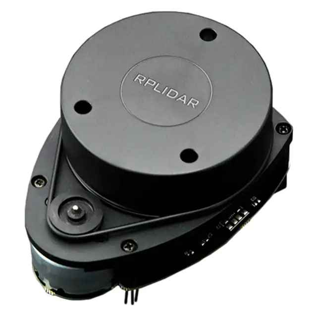
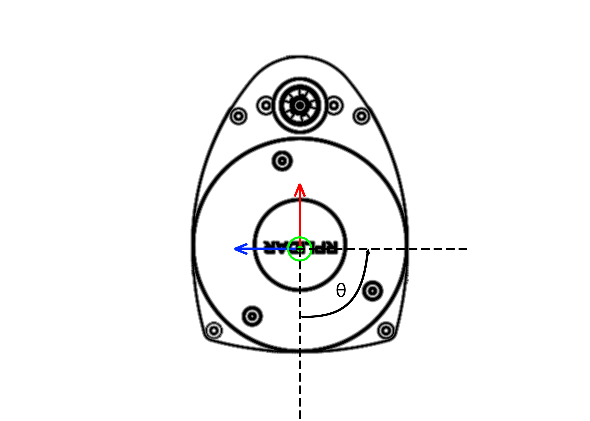
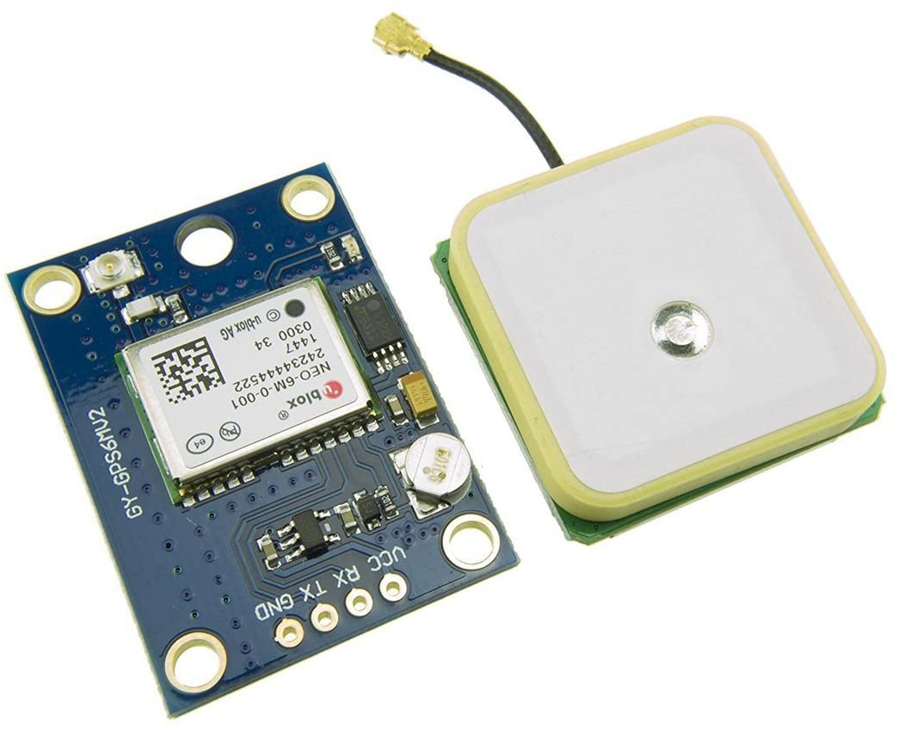

Sensor Information
===================

RPLiDAR
-------

The Slamtec RPLIDAR A1 (A1M8-R6) is a 360-degree single-beam Light Detection and Ranging (LiDAR) sensor used in the vehicle for indoor distance measurements and autonomous control tasks. It provides a rotating array of range measurements that are used in projects such as the PID controller assignment, where students must compute wall distances and feed this information into their controller.

Specifications
^^^^^^^^^^^^^^
* 12 m maximum range  
* 360° field of view  
* 8000 samples per second  
* 5.5 Hz typical scan rate  
* 0.5° angular resolution (720 data points per full scan)

As seen in the image above, the RPLIDAR range readings begin at the negative X-axis and rotate counter-clockwise, producing a ``ranges[]`` array with 720 measurements at 0.5° increments.

Connection and Usage
^^^^^^^^^^^^^^^^^^^^
The unit connects to the computer using a USB-A to Micro-USB cable attached to its USB adapter board (the small green PCB beneath the LiDAR).

The vehicle uses the ROS 2 ``rplidar_ros`` library to run all LiDAR launch files.  
For installation details, refer to the **RPLidar** subsection of the *Packages Needed* page.

Useful Links
^^^^^^^^^^^^
* `Product Sheet <https://mm.digikey.com/Volume0/opasdata/d220001/medias/docus/828/DFR0315_Web.pdf>`_
* `Product Page <https://www.dfrobot.com/product-1125.html>`_
* `Amazon Listing <https://www.amazon.com/youyeetoo-Scanning-Obstacle-Avoidance-Navigation/dp/B0923RYT8V>`_

GPS
---

The GPS unit we are using is a uBlox NEO6M GPS module on a HiLetgo breakout board. The GPS uses NMEA strings to communicate with the Odroid UART port. Essentially, we open a UART connection to the
GPS unit and get back the Latitude and Longitude information for the sensor. We have it set to RMA information, but it can be set to others. Check the `datasheet <https://content.u-blox.com/sites/default/files/products/documents/NEO-6_DataSheet_%28GPS.G6-HW-09005%29.pdf>`_ to see all it can do.

IMU
---

The 9-Axis IMU, BNO055 is currently being used. The sensor has a accelerometer, gyroscope, and magnetometer.
 It is part of the `Arduino Nano Motor Carrier <https://store.arduino.cc/products/arduino-nano-motor-carrier>`_.

Magnetic Encoders
-----------------

The vehicle chassis are currently equiped with two hand made magnetic encoders (hall effect).

Arduino Nano 33 IoT
-------------------

The car uses the Arduino Nano 33 IoT and its Motor Carrier Add-on Board as the primary odometry board.

Originally, it controlled the car’s speed and steering angle while also collecting encoder data and heading values to compute and publish odometry messages.

However, because the board does not provide sufficiently fine PWM precision, it now only sets the steering angle and reads encoder and heading data. The ``RP2040 Zero`` is now responsible for speed control due to its higher-resolution PWM.

Motor Carrier Specs
^^^^^^^^^^^^^^^^^^^
TODO

Deeper Look into PWM
^^^^^^^^^^^^^^^^^^^^^
TODO

Useful Links
^^^^^^^^^^^^
* `Nano Motor Carrier Documentation <https://docs.arduino.cc/hardware/nano-motor-carrier/>`_
* `Nano Motor Carrier Product Page <https://store-usa.arduino.cc/products/arduino-nano-motor-carrier>`_
* `Arduino Nano 33 IoT Documentation <https://docs.arduino.cc/hardware/nano-33-iot/>`_
* `Arduino Nano 33 IoT Product Page <https://store-usa.arduino.cc/products/arduino-nano-33-iot>`_

RP2040 Zero
-----------

The RP2040 Zero is a compact Raspberry Pi Pico–based board manufactured by Waveshare. It is used in the car to achieve proper speed control because the ``Arduino Nano 33 IoT`` Motor Carrier board does not provide sufficient PWM resolution.

TP-Link N300 Travel Router
--------------------------

The TP-Link N300 is a compact travel router that provides a local network for the vehicles, simplifying ROS communication.

It is powered via USB-A to Micro-USB and connects to the computer over Ethernet.

The router assigns the computer a static IP of ``192.168.0.100`` to make SSH connections easier.

Setting It Up
^^^^^^^^^^^^^
TODO: Consult Dr. Crane regarding the TP-Link password.
